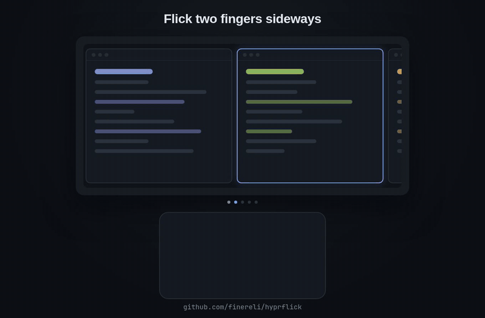

# hyprflick



Flick two fingers sideways on your touchpad and Hyprland's scrolling layout moves one window over.

Hyprland's scrolling layout is a long strip of windows, wider than your screen. You can scroll it with three fingers, but three fingers is also the usual gesture for drag and workspace switching, and two fingers is what your hand expects. Hyprland can't do this on its own. The touchpad driver reports a two-finger swipe as ordinary scrolling, never as a gesture, and Hyprland only lets you bind scrolling from a physical mouse wheel. So it takes a plugin.

Each flick slides the next partly hidden window fully into view. It stops at the first and last window, so you never scroll off into empty desktop, and a flick past the end gives a small boing so you know there's nothing more that way. Focus stays where it was: a flick moves your view, and the window you were typing into keeps the keyboard. That is the difference from the `move +col` command, which moves focus along with the view.

Sideways touchpad scrolling is taken over only on workspaces that use the scrolling layout. Everywhere else your apps get it as usual. Vertical scrolling is never touched.

## Install

With hyprpm:

```sh
hyprpm add https://github.com/finereli/hyprflick
hyprpm enable hyprflick
```

Or build it yourself:

```sh
git clone https://github.com/finereli/hyprflick
cd hyprflick
make
hyprctl plugin load "$PWD/hyprflick.so"
```

Then flick two fingers sideways on a workspace that uses the scrolling layout. Rebuild after every Hyprland update; plugins have to match the exact Hyprland they run in.

---

## For agents

Everything below is reference for an AI agent installing, configuring, or changing this plugin for a user.

### Requirements

- Hyprland 0.56 or newer with the Lua config and the built-in `scrolling` layout. Built and tested on 0.56.2 (aarch64, Arch Linux / Omarchy).
- Hyprland headers matching the running Hyprland exactly. Check with `pkg-config --modversion hyprland` against `hyprctl version`. On Arch the `hyprland` package ships them in `/usr/include/hyprland`.
- `g++` with C++23 support, `make`, `pkg-config`, and the dev headers for pixman, libdrm, pango/cairo, libinput, libudev, wayland-server and xkbcommon. These are present wherever Hyprland itself builds.

### Build and load

```sh
make                                          # produces hyprflick.so
hyprctl plugin load "$PWD/hyprflick.so"       # absolute path required
hyprctl plugin list                           # should list hyprflick
hyprctl plugin unload "$PWD/hyprflick.so"     # unload before reloading a rebuild
```

A plugin runs inside the compositor. A crash in it kills the user's whole session, so tell the user before loading an untested build.

On a header mismatch the plugin shows a red notification and refuses to load. The fix is always a rebuild against the current headers.

### Load at startup (Lua config)

Add to `~/.config/hypr/hyprland.lua`, or a file it requires:

```lua
hl.plugin.load(os.getenv("HOME") .. "/path/to/hyprflick/hyprflick.so")
```

If the user installed through hyprpm, have hyprpm load its enabled plugins at startup instead, e.g. `hyprpm reload -n` from their autostart.

### Options

Set them from Lua after the plugin loads. All are optional.

```lua
hl.config({
  plugin = {
    hyprflick = {
      enabled = true,   -- turn flicks on or off
      threshold = 15,   -- sideways scroll distance (libinput scroll units, roughly px) before a flick fires
      invert = false,   -- reverse direction
      gap_ms = 150,     -- a pause this long ends one flick and starts the next
      bounce = 40,      -- px to boing past either end when there's nothing more to scroll to (0 = off)
    },
  },
})
```

Check a value with `hyprctl getoption plugin:hyprflick:threshold`.

Tuning: if light brushes move the view, raise `threshold`. If deliberate flicks don't register, lower it. If two fast flicks in a row move only once, lower `gap_ms`. If the direction feels backwards (it follows the user's `natural_scroll` setting), set `invert = true`. To change or turn off the end-of-strip boing, set `bounce`.

### How it works

All of it is in `main.cpp`.

1. It listens to `Event::bus()->m_events.input.mouse.axis`, a cancellable event that fires for every scroll event before Hyprland routes it to a window.
2. It ignores anything that isn't from a touchpad (`WL_POINTER_AXIS_SOURCE_FINGER`) or isn't on a workspace whose tiled algorithm is `scrolling` (checked through `Layout::Supplementary::algoMatcher()->getNameForTiledAlgo`). The workspace is the active one on the focused monitor.
3. On scrolling workspaces it cancels every horizontal finger scroll event, so apps don't also scroll sideways. Vertical events pass through untouched, but their deltas are counted.
4. A flick is a run of finger scroll events with no gap over `gap_ms` and no zero-delta event (libinput's stop event when fingers lift). Once the horizontal total passes `threshold` and is at least twice the vertical total, it fires once and ignores the rest of the flick. The 2x rule keeps a slightly diagonal vertical scroll from moving the tape.
5. Firing computes a new tape offset from `CScrollTapeController`. Forward: the first column whose right edge sticks out past the viewport's right edge gets aligned with that edge. Backward: the first column hidden past the left edge gets aligned with the left edge. The result is clamped to `[0, maxExtent - viewport]`. Then `SScrollingData::recalculate()` animates the move. Focus is never touched.
6. If no column is hidden in that direction, it boings instead: the offset moves `bounce` px past the end, and a `CEventLoopTimer` puts it back after 120 ms. Hyprland's window move animation turns that into a spring. A new flick during a boing ends the boing first.
7. Hyprland's `CScrollTapeController::calculateCameraOffset` resets a negative offset to 0 when `scrolling:focus_fit_method` is 1 (fit), which would cancel a boing past the left end. So for a left-side boing the plugin sets that option to 0 (center) through `CConfigValue::ptr()` and restores it when the boing ends, including on unload. A function hook on `calculateCameraOffset` would be cleaner, but Hyprland's hook system only works on x86_64.

Known limit: when all windows on a workspace fit on screen, Hyprland centers them by force, so the boing doesn't show there.

The plugin reaches the private `m_scrollingData` member of `CScrollingAlgorithm` through `#define private public` around the include, the same trick the official hyprland-plugins use. That couples it to Hyprland internals, so a Hyprland release that reworks the scrolling layout can break the build.

### Things that don't work, and why

These were tried first. Don't retry them.

- **`hl.gesture({ fingers = 2, direction = "horizontal", ... })`**: registers fine and never fires. libinput emits two-finger motion as scroll events and only produces swipe gestures for 3+ fingers. Two-finger `hl.gesture` only works for pinches.
- **`hl.bind("mouse_left"/"mouse_right", ...)`**: never fires for touchpads. `CKeybindManager::onAxisEvent` matches scroll binds only when `e.source == WL_POINTER_AXIS_SOURCE_WHEEL`.
- **`hl.dsp.layout("move +col")`**: moves focus to the next column along with the view, and at the last column scrolls to an empty max offset. That's why the plugin sets the offset itself.

### Files

- `main.cpp`: the whole plugin.
- `Makefile`: one-line build, flags copied from the official hyprland-plugins.
- `demo/`: Remotion source for the README animation (`npx remotion render src/index.ts Demo out/hyprflick.mp4`).
- `docs/hyprflick.gif`: the README animation.
- `hyprpm.toml`: manifest for `hyprpm add`. To support older Hyprland versions later, pin plugin commits to Hyprland commits in `commit_pins`.

## License

MIT
